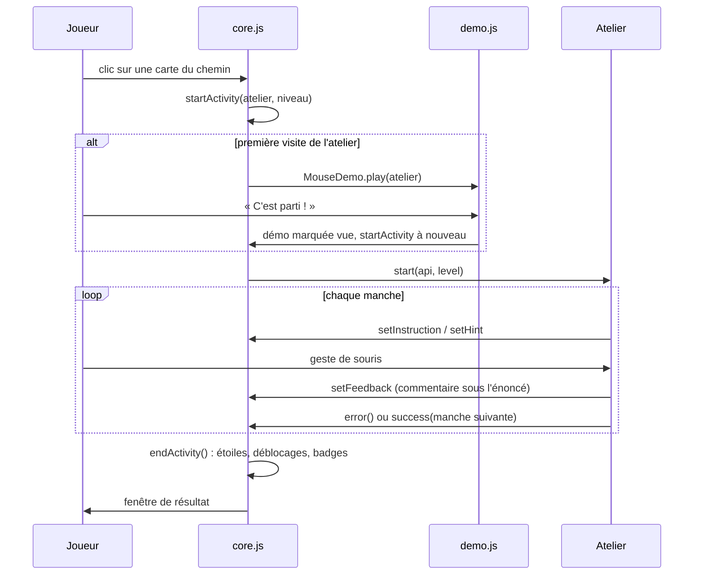

# Architecture

## Principes

- **Page statique, sans dépendance.** Pas de framework, pas de bibliothèque, pas de compilation. Le jeu doit pouvoir s'ouvrir par un double-clic sur `index.html`.
- **Scripts classiques, pas de modules ES.** Les modules (`type="module"`) sont bloqués par les navigateurs quand la page est ouverte en `file://`. Les fichiers communiquent par deux objets globaux : `window.MouseGame` et `window.MouseDemo`.
- **Un fichier par atelier.** Le noyau ne connaît aucun atelier. Chacun s'enregistre avec `MouseGame.register()`.
- **Tout en français**, y compris les commentaires et les messages de commit.

## Fichiers

```
index.html              Structure de la page (menu, écran de jeu, fenêtres)
style.css               Toute la mise en forme
js/core.js              Noyau : menu, chemin, niveaux, partie, score, étoiles, sauvegarde
js/demo.js              Démonstrations animées (une scène par atelier)
js/ateliers/*.js        Un fichier par atelier
js/tests.js             Tests automatiques, chargés seulement avec index.html?test
```

| Atelier | `id` | Fichier | Place sur le chemin (`order`) |
| --- | --- | --- | --- |
| Survol | `survol` | `survol.js` | 5 |
| Clic gauche | `gauche` | `clics.js` | 10 |
| Clic droit | `droit` | `clics.js` | 20 |
| Double-clic | `double` | `double-clic.js` | 25 |
| Bouton central | `central` | `clics.js` | 30 |
| Molette | `molette` | `molette.js` | 40 |
| Barre de défilement | `barre` | `barre.js` | 45 |
| Glisser-déposer | `glisser` | `glisser.js` | 50 |
| Sélection de texte | `selection` | `selection.js` | 60 |
| Sélection multiple | `multiple` | `multiple.js` | 70 |
| Grand défi | `melange` | `clics.js` | 90 |
| Ranger le bureau (mission finale) | `mission` | `mission.js` | 95 |

`clics.js` regroupe 4 ateliers : ils partagent la même grille de clic, avec des options différentes.

## Ordre de chargement

`index.html` charge les scripts dans cet ordre, à la fin du `<body>` (le DOM est donc déjà prêt) :

1. `js/core.js` crée `window.MouseGame`.
2. `js/demo.js` crée `window.MouseDemo`. Il utilise `MouseGame.mouseSvg`, `MouseGame.ICONS` et `MouseGame.speed`.
3. `js/ateliers/*.js` appellent `MouseGame.register(...)`. L'ordre des balises n'a pas d'importance : le noyau trie les ateliers par `order`.
4. Un script en ligne appelle `MouseGame.start()`, qui affiche le menu. Avec `?test`, il ajoute aussi `js/tests.js`.

## Structure de la page

`index.html` contient 4 blocs. Les éléments utilisés par le code ont un `id` :

| Bloc | Éléments principaux |
| --- | --- |
| Menu `#menu` | `#badges` (étagère de badges), `#cards` (le chemin), `#resetProgress` |
| Écran de jeu `#game` | `#backButton`, `#gameTitle`, `#levelText`, `#demoButton`, `#skipMiddle`, `#mouseHint`, `#message`, **`#board`**, `#score`, `#errors`, `#timer` |
| Fin de partie `#resultModal` | `#resultMessage`, `#resultDetail`, `#nextLevelButton`, `#nextActivityButton`, `#replayButton`, `#menuButton` |
| Démonstration `#demoModal` | `#demoTitle`, `#demoScene`, `#demoMouse`, `#demoCaption`, `#demoReplay`, `#demoGo` |

Un atelier ne dessine que dans **`#board`** (reçu comme `api.board`). Il change l'énoncé, le commentaire et le dessin de souris par l'API (`setInstruction`, `setFeedback`, `setHint`), jamais directement. Dans la page, l'énoncé est dans `#instruction` (en gras) et le commentaire juste en dessous, dans `#feedback`.

## Déroulement d'une partie



1. **`startActivity(activity, number)`** arrête la partie précédente (`stopActivity`), prépare l'écran et vide `#board`. Si la démo de l'atelier n'a jamais été vue (hors mode test), elle est jouée d'abord. Ensuite, le chronomètre démarre et le noyau appelle `activity.start(api, level)`.
2. **L'atelier** construit son plateau dans `api.board`, affiche la consigne, écoute les gestes et appelle :
   - `api.error()` pour une erreur, qui fait perdre des étoiles ;
   - `api.success(next, delay)` pour une manche réussie. Après `delay` ms, le noyau appelle `next()` pour la manche suivante, ou termine la partie au bout de `level.rounds` réussites.
3. **`endActivity()`** calcule les étoiles, les enregistre et ouvre la fenêtre de résultat. Celle-ci annonce le niveau débloqué, l'atelier suivant, un nouveau badge ou le diplôme.

### Arrêt propre : `runId`, `later` et `onCleanup`

Le joueur peut revenir au menu à tout moment. Pour qu'aucune minuterie de l'ancienne partie ne s'exécute ensuite :

- `stopActivity()` incrémente `runId` ;
- `api.later(fn, ms)` mémorise le `runId` du moment et n'appelle `fn` que s'il n'a pas changé ;
- `api.onCleanup(fn)` enregistre un nettoyage (retirer un écouteur sur `document`, effacer une sélection…), exécuté par `stopActivity()`.

**Règle :** dans un atelier, utilisez toujours `api.later` plutôt que `setTimeout`. Si un écouteur est posé ailleurs que dans `api.board` (sur `document`, par exemple), retirez-le dans un `onCleanup`.

## Progression

### Étoiles

À la fin d'un niveau, le noyau compte les erreurs :

| Erreurs | Étoiles |
| --- | --- |
| 0 ou 1 | ★★★ |
| 2 à 4 | ★★☆ |
| 5 ou plus | ★☆☆ |

Seul le meilleur résultat est conservé.

### Niveaux

Chaque atelier a 3 niveaux. Le niveau *n* s'ouvre avec au moins **★★** au niveau *n − 1* (constante `STARS_TO_UNLOCK`). Le niveau proposé par défaut, encadré en vert, est le premier niveau ouvert qui n'a pas encore ★★★.

### Chemin

Le menu présente les ateliers dans l'ordre de `order`, 6 par ligne (constante `PER_ROW` de `renderMenu`), une ligne sur deux de droite à gauche.

- Un atelier est **franchi** avec ★★ à son niveau 1. Le bouton central compte aussi comme franchi si le joueur a indiqué ne pas en avoir (`noMiddle`).
- Un atelier est **ouvert** si tous les ateliers précédents sont franchis, **ou** s'il a déjà été commencé (au moins une étoile à un niveau). La seconde règle évite de bloquer la progression existante quand un nouvel atelier est inséré dans le chemin.
- **« Vous êtes ici »** désigne le premier atelier ouvert pas encore franchi, sinon le premier atelier sans badge.

### Badges

Un atelier rapporte son badge (`activity.badge`) avec ★★ à son **dernier** niveau. Avec tous les badges, le joueur obtient le diplôme. Sans bouton central, le badge de cet atelier n'est pas demandé.

### Mode libre

Le mode libre n'est **pas** un atelier enregistré : il ne compte ni dans le chemin ni dans les badges. Il est géré par le noyau (`startFreeMode`, `nextFreeExercise`, `playFreeExercise`).

- **Ouverture :** `isFreeUnlocked()` est vrai quand chaque niveau de chaque atelier a au moins une étoile. Sans bouton central, cet atelier n'est pas demandé. Le bouton `#freeButton` n'est ajouté au menu qu'à ce moment-là, et la fenêtre de fin de partie l'annonce.
- **Tirage :** à chaque exercice, un atelier au hasard (jamais deux fois de suite le même), puis un de ses niveaux au hasard. Le noyau appelle `start(api, level)` avec une copie du niveau où `rounds` vaut 1 : une seule manche. La mission remplace elle-même `rounds` par son nombre de tâches, elle est donc jouée en entier.
- **Enchaînement :** quand l'exercice est réussi, `success()` lance l'exercice suivant au lieu de terminer la partie. `stopExercise()` nettoie l'exercice précédent sans arrêter le chronomètre.
- **Compteurs :** réussites, série sans erreur (remise à 0 par `error()`) et record, enregistré dans le réglage `freeRecord`.
- Le plateau porte `data-activity` et `data-level`, car le titre affiche seulement « Mode libre ». Les tests s'en servent pour savoir à quoi ils jouent.

### Sans bouton central

Le bouton `#skipMiddle` s'affiche pour les ateliers qui ont `usesMiddle: true`. Il enregistre le réglage `noMiddle` :
- l'atelier « Bouton central » est passé et compte comme franchi ;
- le Grand défi n'utilise plus que les boutons gauche et droit.

Terminer ensuite une partie de l'atelier « Bouton central », quel que soit le résultat, remet `noMiddle` à `false` : le joueur a donc bien un bouton central.

## Sauvegarde

Tout est enregistré dans le `localStorage` du navigateur, sous deux clés au format JSON :

| Clé | Contenu | Exemple |
| --- | --- | --- |
| `mouseClicGame.stars` | Meilleures étoiles par niveau, sous la clé `"atelier.niveau"` | `{"gauche.1": 3, "gauche.2": 2}` |
| `mouseClicGame.settings` | Réglages : `noMiddle` (booléen), `demosSeen` (démos déjà vues), `freeRecord` (record de série du mode libre) | `{"noMiddle": true, "demosSeen": {"gauche": true}, "freeRecord": 12}` |

- En mode test, les clés sont préfixées par `test.`, pour ne jamais toucher à la vraie progression.
- **Compatibilité :** avant les niveaux, les étoiles étaient enregistrées sous la seule clé `"gauche"`. `getStars` les compte encore comme des étoiles du niveau 1.
- Les lectures et écritures sont protégées par `try/catch`. Si le stockage est indisponible (navigation privée, par exemple), le jeu fonctionne sans sauvegarde.
- « Effacer ma progression » supprime les deux clés, y compris les démos déjà vues.
